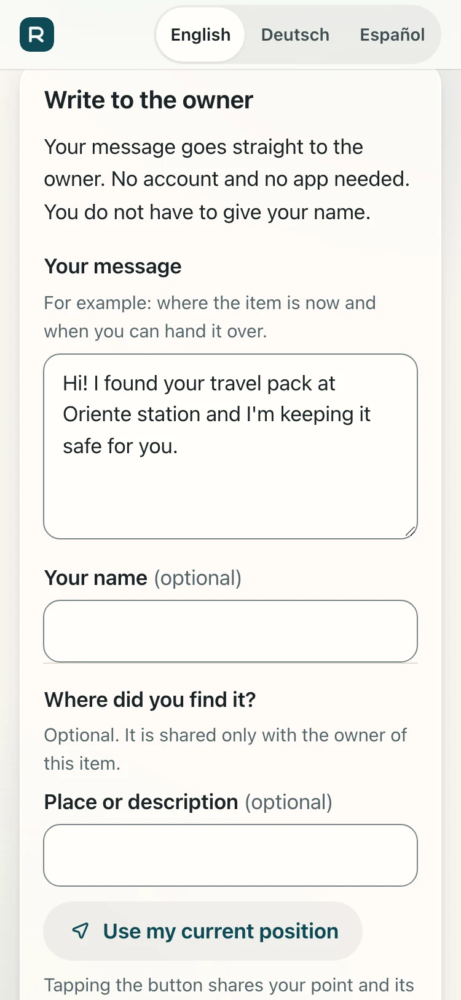
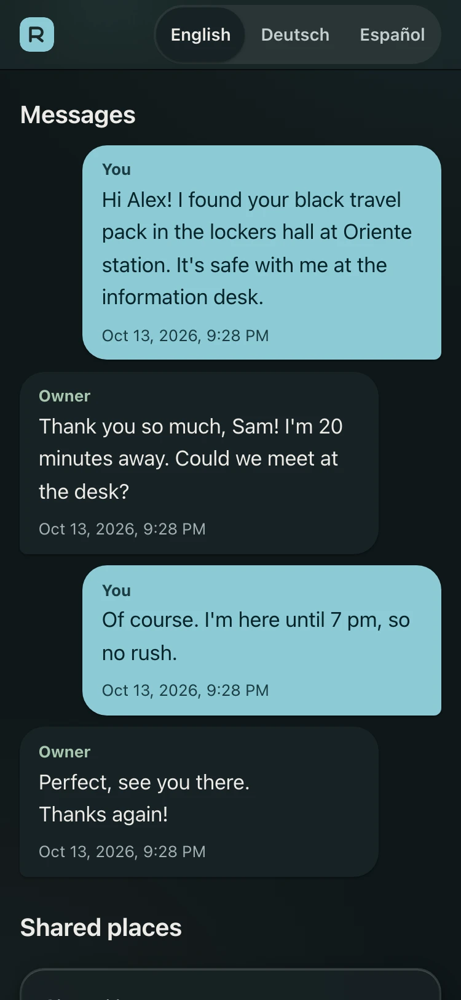
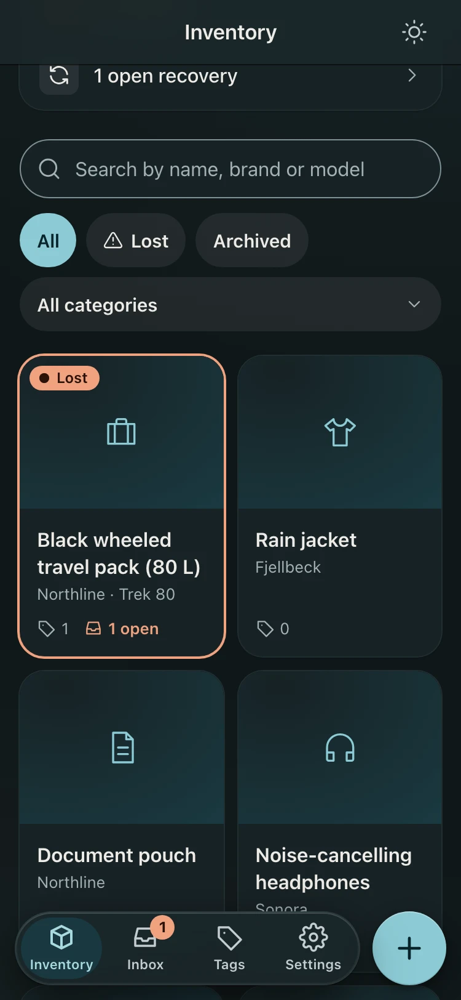
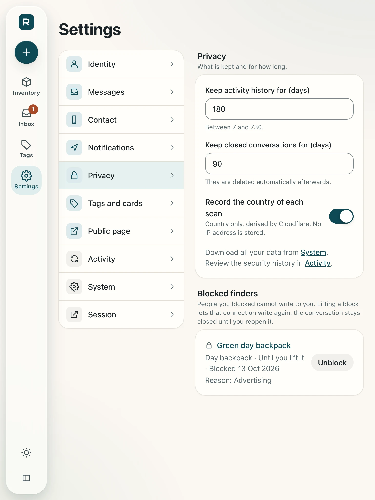
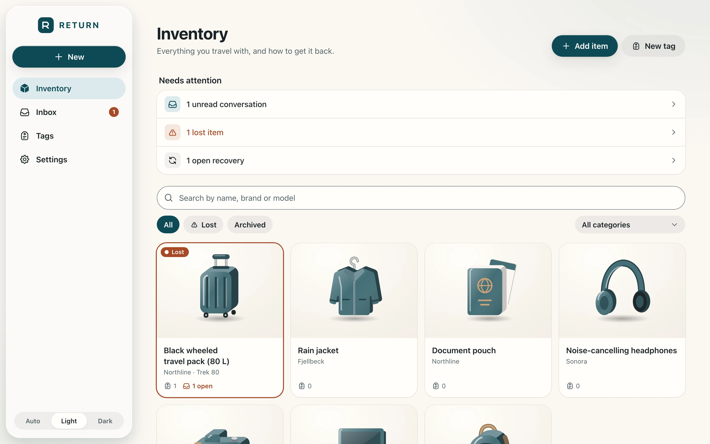
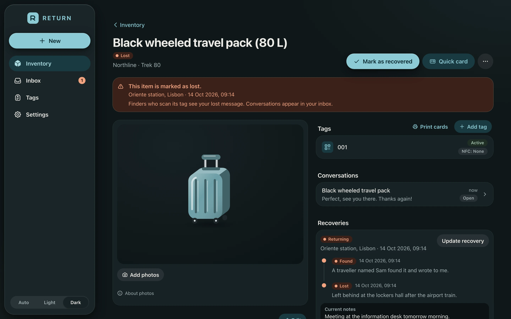
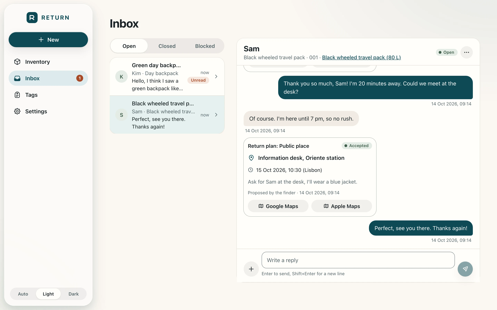
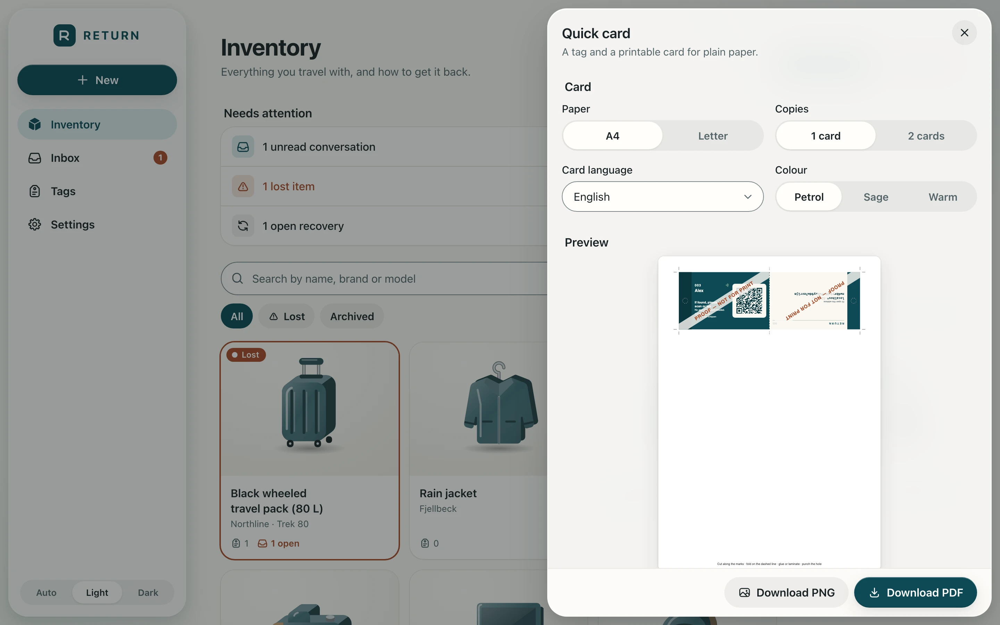

# RETURN

RETURN is a personal inventory of belongings with QR/NFC tags. A tag on an item links to a public page where
whoever finds the item can message the owner, optionally share where they found it, and agree a return. The
finder needs no account and no app.

Privacy is the main design constraint: a stranger must be able to reach the owner quickly, and nobody but the
owner can see the inventory, other conversations or documents.

RETURN is single-owner and self-hosted. You run it on your own Cloudflare account. It is not a SaaS and there is
no shared instance for other people to sign up to.

## Features

- **Finder pages** (`/t/<token>`) in English, German and Spanish. A finder can see the public card, start a
  conversation, and share a location after an explicit tap. First contact is protected by Cloudflare Turnstile
  and per-IP, per-tag and per-conversation rate limits.
- **Owner panel** at a separate host, behind Cloudflare Access. Manage items, tags, conversations, return plans
  and recoveries, and settings.
- **Printable cards**: a card layout (CR80 size, with bleed and trim marks), plus a quick paper card as PNG or PDF.
  Printing notes are in `docs/printing.md`.
- **Place names** for shared coordinates via OpenStreetMap Nominatim. Coordinates are shown when no name resolves.
- **Email alerts** to the owner through Cloudflare Email Service (`send_email` binding).
- **Installable owner PWA** (service worker never caches private data).
- **Web Push** for the owner: in progress.

## Screenshots

All data is fictional. Regenerate with `pnpm screenshots` (see `docs/screenshots/README.md`).

<table>
  <tr>
    <td align="center" width="25%"><br><sub>Finder writes to the owner, no account needed</sub></td>
    <td align="center" width="25%"><br><sub>Private conversation link, dark</sub></td>
    <td align="center" width="25%"><br><sub>Owner panel on a phone, Liquid Glass</sub></td>
    <td align="center" width="25%"><br><sub>Privacy settings and blocked finders</sub></td>
  </tr>
</table>

<table>
  <tr>
    <td align="center" width="50%"><br><sub>Inventory</sub></td>
    <td align="center" width="50%"><br><sub>Lost item with its recovery timeline</sub></td>
  </tr>
  <tr>
    <td align="center" width="50%"><br><sub>Inbox: shared location and agreed return plan</sub></td>
    <td align="center" width="50%"><br><sub>Quick paper card</sub></td>
  </tr>
</table>

## Architecture

```
 finder browser ──> return.<domain>      ─┐
                                          ├─> one Cloudflare Worker (Hono)
 owner browser  ──> app.return.<domain> ─┘     ├─ /t, /c        server-rendered finder pages
 (Cloudflare Access)                            ├─ /api          owner JSON API (Access JWT checked)
                                                ├─ static assets React SPA (owner panel)
                                                ├─ D1 (SQLite)   inventory, tags, conversations
                                                ├─ R2 (private)  photos and documents
                                                └─ cron          retention and nightly backups
```

- One Worker, two Custom Domains. The Worker decides per host what to serve.
- Finder pages are server-rendered with a strict CSP and no React bundle.
- Files are stored in a private R2 bucket and served only through authenticated routes.

## Stack

TypeScript · Hono 4 · Cloudflare Workers with Static Assets · React 19 + Vite 8 + Tailwind 4 · D1 · R2 ·
Cloudflare Access · Turnstile · Workers Rate Limiting · zod 4 · Vitest 4 · Playwright.
Versions are pinned in `package.json`. Decisions are in `docs/decisions.md`.

## Repository layout

| Path | Contents |
|---|---|
| `src/worker/` | Worker: host routing (`index.ts`), owner API (`api/`), auth (`auth/`), D1 access (`db/`), services, finder pages (`public/`) |
| `src/app/` | Owner panel SPA (React) |
| `src/shared/` | zod schemas, QR, map links, card layouts; shared by Worker and SPA |
| `src/sw/` | Owner PWA service worker |
| `public/p/` | Static files for finder pages (served without the Worker) |
| `migrations/` | D1 SQL migrations; applied migrations are never edited |
| `test/`, `e2e/` | Unit and integration tests (in workerd), Playwright end-to-end tests |
| `scripts/` | Release guard, VAPID key generation, icon generation, backup and restore helpers |
| `docs/` | Decisions, security, operations, printing, design system, ADRs, specs, architecture |

## Run locally

Requires Node 24 (see `.node-version`) and pnpm.

```bash
fnm use                     # Node 24
pnpm install
cp .dev.vars.example .dev.vars   # local secrets; git-ignored, never commit it
pnpm db:migrate:local
pnpm dev                    # panel at http://localhost:5173, tag pages at /t/<token>
```

Locally the panel is reachable without Access through a loopback-only development bypass. The dev bypass only
works on loopback hosts.

## Quality gates

```bash
pnpm lint && pnpm typecheck && pnpm test   # Biome, tsc, Vitest (unit and integration)
pnpm test:e2e                               # Playwright, mobile and desktop viewports
```

## Deploy your own

The full procedure is in [`docs/operations.md`](docs/operations.md). In short:

1. **Cloudflare account.** Workers Paid is required for Email Service (sending). The rest runs on the free tiers.
   Put your domain's zone on Cloudflare.
2. **Resources.** Create the D1 database (EU jurisdiction) and the private R2 bucket. Apply migrations.
3. **Access.** Create a self-hosted Access application for the panel host only, with an Allow policy for your own
   email address.
4. **Turnstile.** Create a widget for your finder host (managed mode).
5. **Secrets.** Never commit these. Set them with Wrangler:
   - `TURNSTILE_SECRET_KEY`
   - `IP_HMAC_SECRET`
   - `VAPID_PRIVATE_KEY` (generate the pair with `node scripts/vapid-keys.mjs`)
6. **Configuration.** `cp wrangler.example.jsonc wrangler.jsonc` (git-ignored) and replace every placeholder:
   `routes` (hosts), `PUBLIC_HOST`, `APP_HOST`, `ACCESS_TEAM_DOMAIN`, `ACCESS_AUD`, `OWNER_EMAILS`, `NOTIFY_FROM`,
   `FALLBACK_CONTACT_EMAIL`, `TURNSTILE_SITE_KEY`, `VAPID_PUBLIC_KEY`, and the D1 `database_id`.
7. **Release.** `pnpm run release --migrate` runs the guarded release: it refuses dirty trees and unapplied
   migration problems, runs the gates, deploys, and checks the public endpoints.

Only the template `wrangler.example.jsonc` is committed. Tests, E2E and `pnpm cf-typegen` always use it; `pnpm dev`
uses your `wrangler.jsonc` when it exists and the template otherwise.

## Documentation

- [`docs/decisions.md`](docs/decisions.md): architecture decision matrix and verified platform facts
- [`docs/security.md`](docs/security.md): threat model, mitigations and accepted residual risks
- [`docs/operations.md`](docs/operations.md): setup, configuration, deploy, backups, restore, degraded behaviour
- [`docs/printing.md`](docs/printing.md): card production and printers
- [`docs/design/system.md`](docs/design/system.md): design system
- [`docs/adr/`](docs/adr/): architecture decision records
- [`docs/specs/`](docs/specs/): feature specifications
- [`docs/architecture/next-phases.md`](docs/architecture/next-phases.md): roadmap and architecture for the next phases
- [`SECURITY.md`](SECURITY.md): how to report a vulnerability

## Status and roadmap

Current: finder pages, owner panel, items, tags, conversations, return plans, recoveries, printable cards, place
names, email alerts and the installable owner PWA.

Next, in order (see `docs/architecture/next-phases.md`):

1. Owner Web Push (in progress; ADR 0003)
2. Finder PWA and finder push
3. Sealed end-to-end encrypted conversations (ADR 0004)
4. Optional native app with Expo (ADR 0005)

## License

[MIT](LICENSE). Fork it and run your own instance (see "Deploy your own").
